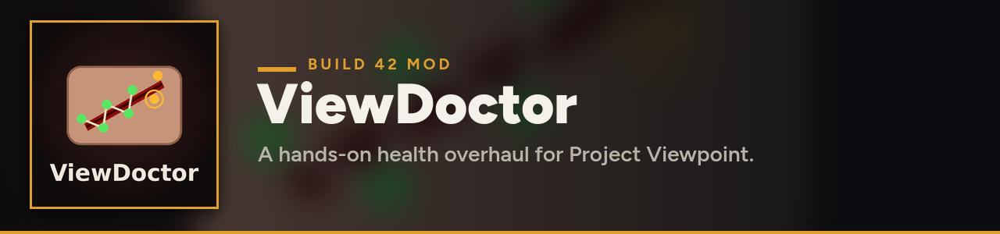
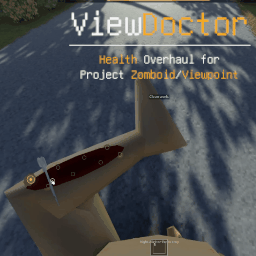
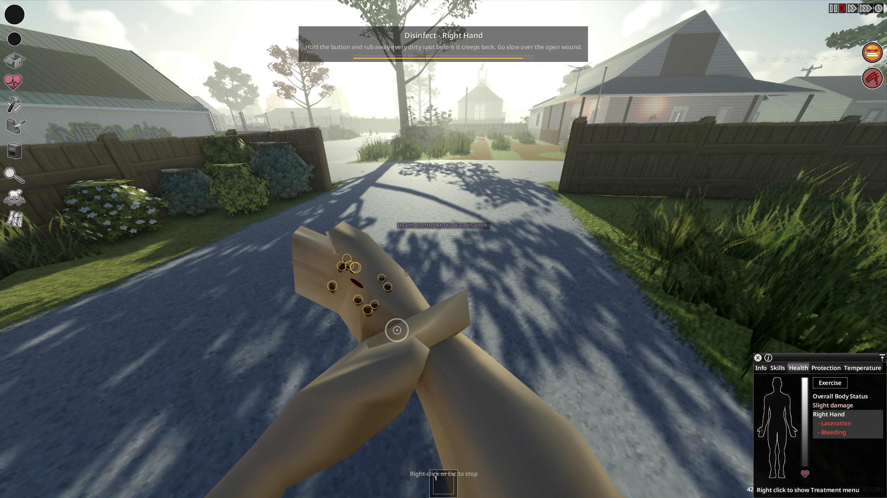
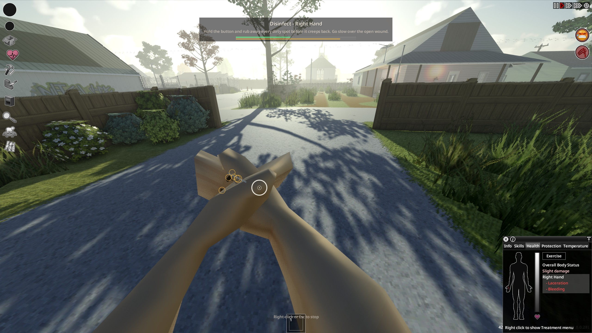
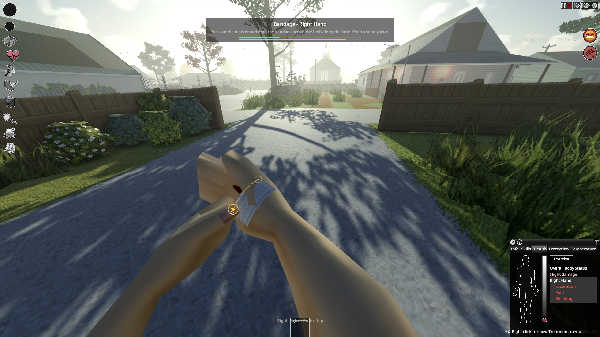
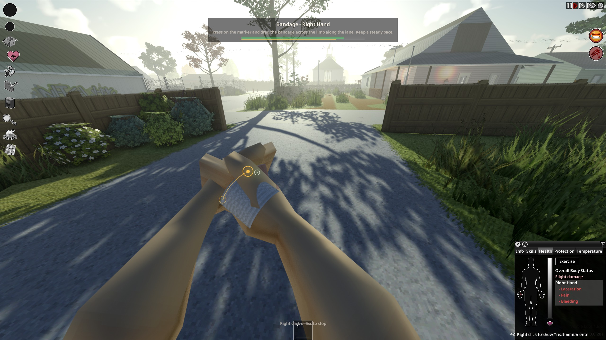

<p align="center"></p>

# ViewDoctor | Health Overhaul for Project Zomboid/Viewpoint

Patching yourself up is no longer a progress bar. Your character lifts the hurt arm or crosses the hurt leg in front of Project Viewpoint's first-person camera, and you do the work with the mouse right on that limb, with 3D tools and a 3D wound sitting on it.

**[Get it on the Steam Workshop](https://steamcommunity.com/sharedfiles/filedetails/?id=3838091936)**

> **Work in progress.** The mod is in early development. Expect bugs, missing content and big changes. Bug reports and ideas are welcome in the [issues](../../issues).

<p align="center"></p>

## Previews

| | |
|:-:|:-:|
|  |  |
|  |  |
|  |  |

## The minigames

- **Stitching:** pull the thread through each dot across the wound. Stray off the line or rush it and the thread tears.
- **Removing stitches:** snip each knot right when the closing ring meets it.
- **Bandages and splints:** wrap each pass across the limb at a steady pace. Taking one off is the same, the other way round.
- **Disinfecting, cleaning burns, poultices:** rub away the dirt before it creeps back, slowly over the open wound.
- **Glass:** grab each shard and pull it out slowly along its line.
- **Bullets:** hold the probe still until you find the bullet, then pull.
- **Injections and blood draws:** hit the vein, hold still, then slide slowly to push the plunger.

## How it plays

- In first person the wound, stitches, bandage wraps, shards, dirt and the tool in your free hand are 3D models on the limb. They move with it and hide behind your hands.
- In isometric view, in a car, and for the head, neck, chest and groin, the game is drawn on a flat limb at the centre of the screen.
- Your character takes off clothing that covers the wound first and puts it back on when you are done or when you stop. A sandbox option turns this off.
- Your hand shakes. Pain, panic, being drunk, exhausted, cold or tired make it worse. First Aid skill steadies it and makes the targets bigger.
- Clean work heals faster, stops bleeding and rarely infects. Sloppy work heals slower, can keep bleeding, often infects, and can leave glass or a bullet behind.
- Botch it and the treatment fails: more pain, and the wound can start bleeding again.
- Right-click or Esc stops at any time with no penalty.
- Treating another player works too. You get the minigame, they get the result.

## Compatibility

- **Extensive Health Rework Evolved:** replaces EHR's stitching minigame and passes your score to EHR. Transfusions, drawing blood, injections, IV and emergency shots are needle minigames.
- **The Only Cure:** amputation is a sawing minigame, cauterizing is holding the hot metal still, and cleaning the stump is scrubbing. With a hand gone, every minigame is harder.
- **Fancy Handwork / Brutal Handwork:** works with off-hand items and their action changes.
- **The Only Cure x Extensive Health Rework Compatibility**

## Requirements

- Project Zomboid Build 42.21 or newer
- [ZombieBuddy](https://steamcommunity.com/sharedfiles/filedetails/?id=3619862853)
- Project Viewpoint is optional. Without it, or outside first person, the minigames work the same on a drawn limb.

Singleplayer and multiplayer. Safe to add to an existing save and safe to remove.

Languages: English, Polski, Deutsch, Français, Español, Português (BR), Русский.

## Sandbox options

| Option | What it does |
|---|---|
| `ViewDoctor.Enabled` | Turns the minigames on or off |
| `ViewDoctor.Difficulty` | Easy, Normal or Hard |
| `ViewDoctor.TimeLimit` | Time limit for a minigame |
| `ViewDoctor.QualityEffects` | Whether quality changes healing, bleeding and infection |
| `ViewDoctor.BotchPenalty` | Whether a botched treatment hurts |
| `ViewDoctor.InstantOnServer` | Skips the server-side timer (trusts each player's game) |
| `ViewDoctor.Undress` | Takes off clothing over the treated part |

## Repository layout

```
Contents/mods/ViewDoctor/
  42/media/lua/client/ViewDoctor/   panel, minigame flow, undressing, 3D scene
  42/media/lua/shared/ViewDoctor/   minigame rules, treatments, effects
  42/media/lua/server/ViewDoctor/   multiplayer commands
  42/media/models_X/ViewDoctor/     prop models (.x)
  42/media/java/client/             ViewDoctor.jar and its ZombieBuddy signature
  source/viewdoctor/                Java source of ViewDoctor.jar
tests/                              Lua and Java tests
tools/models.py                     generates the prop models and textures
build.sh                            builds, signs and tests the jar
gif.py                              uploads preview.gif to the Workshop item
```

## Building

The Java part (poses, 3D props, cursor casting) runs through ZombieBuddy.

```sh
./build.sh
```

Needs JDK 17 or newer and OpenSSL. `GAME` points to the `projectzomboid` folder of your install and `ZB` to `ZombieBuddy.jar`. The script signs the jar for ZombieBuddy with `KEY` and `STEAMID`. If you publish your own build, sign it with your own key and Steam ID.

## Tests

```sh
for t in tests/test_*.lua; do lua5.1 "$t" Contents/mods/ViewDoctor/42/media/lua; done
```

`build.sh` also runs `tests/ReachTest.java` against the built classes.

## License

[CC BY-NC 4.0](LICENSE). You may edit, remix and share ViewDoctor with credit, for non-commercial use only. Project Zomboid and its assets belong to The Indie Stone.
